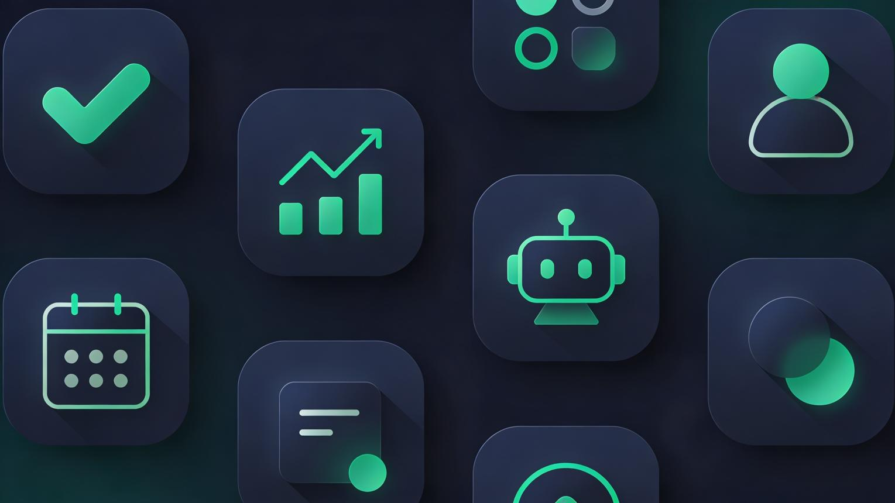

# Quality of Life

### Small tools. Smarter workflows. Easier living.

Quality of Life is a growing collection of practical tools, scripts, applications, automations, and resources designed to simplify everyday life, improve productivity, and reduce repetitive tasks.

This repository is built through collaboration with Claude and various AI models and agents, leveraging artificial intelligence to explore ideas, accelerate development, and create practical solutions to everyday problems.

## Purpose

- Simplify everyday tasks.
- Automate repetitive processes.
- Improve personal productivity.
- Save time and effort.
- Explore AI-assisted development.
- Turn everyday problems into practical solutions.

## AI-Assisted Development

This project embraces human–AI collaboration. AI models and agents are used to assist with brainstorming, development, debugging, optimization, and experimentation, while maintaining human oversight and continuous learning.

## What's Inside?

This repository will continuously expand with new tools, utilities, scripts, automations, and other quality-of-life improvements.

## Philosophy

Technology should make life easier, not more complicated.

Every small improvement matters.
